<h2>TensorFlow-FlexUNet-Image-Segmentation-Simple-Bone-Fracture (2026/10/16)</h2>
<h3>Simple-Bone-Fracture: AI Generated Pseudo Masks Segmentation Challenge</h3>
Sarah T. Arai 
Software Laboratory antillia.com  

This is the first experiment of Image Segmentation for <b>Simple-Bone-Fracture </b>
 based on
our <a href="https://github.com/sarah-antillia/TensorFlow-FlexUNet-Image-Segmentation-Model">TensorFlowFlexUNet Model</a>
 (<b>TensorFlow Flexible UNet Image Segmentation Model for Multiclass</b>) and a 512x512-pixel cropped PNG
 <a href="https://drive.google.com/file/d/1nn1wLu2pPTH9N743r9aMCPVlsRyyVkLi/view?usp=sharing">
Augmented-Simple-Bone-Fracture-ImageMask-Dataset.zip</a> 
(<a href="https://creativecommons.org/licenses/by/4.0/">CC BY 4.0</a>
), 
which was derived by us from 
  
<b>Simple Bone Fracture </b> subset of  
<a href="https://www.kaggle.com/datasets/orvile/simple-vs-comminuted-fractures-x-ray-data">
<b>Simple vs Comminuted Fractures X-ray Data</b>
</a> by Orvile.
  

<b>Actual Image Segmentation for Simple-Bone-Fracture Images of 512x512 pixels</b> 
As shown below, the inferred masks resemble the ground-truth masks except for the first case.  
 
<table>
<tr>
<th width="320" height="auto">Input: image</th>
<th width="320" height="auto">Mask (ground_truth)</th>
<th width="320" height="auto">Prediction: inferred_mask</th>
</tr>
<tr>
<td></td>
<td></td>
<td></td>
</tr>
<tr>
<td>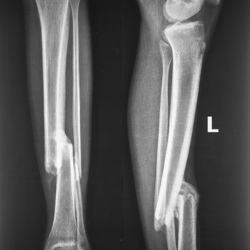</td>
<td>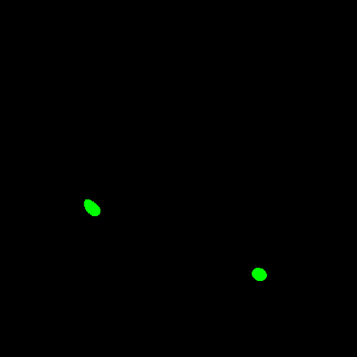</td>
<td>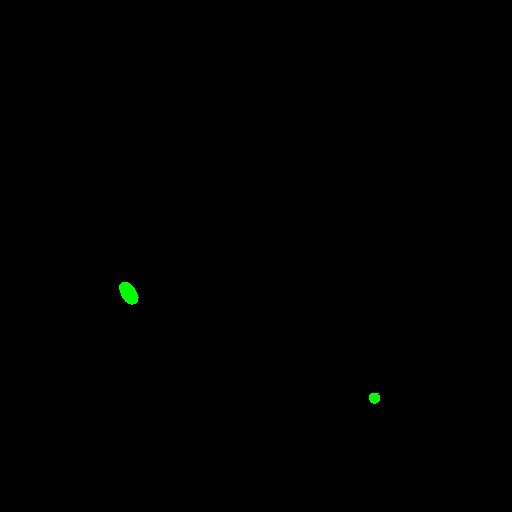</td>
</tr>
<tr>
<td>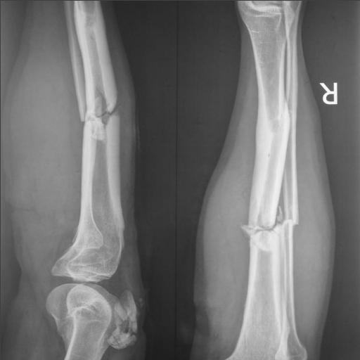</td>
<td>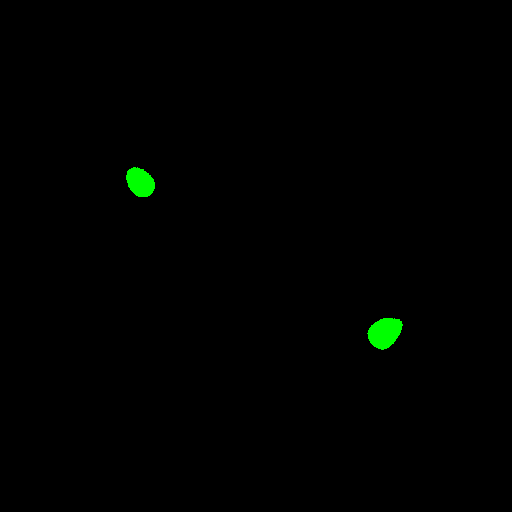</td>
<td>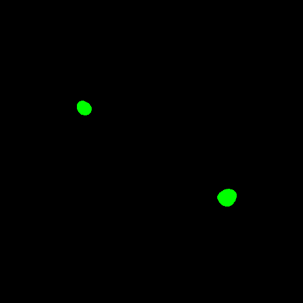</td>
</tr>
</table>

 
<h3>1. Dataset Citation</h3>
The dataset used here was derived from the following Kaggle:  
<b>Simple Bone Fracture </b> subset of  
<a href="https://www.kaggle.com/datasets/orvile/simple-vs-comminuted-fractures-x-ray-data">
<b>Simple vs Comminuted Fractures X-ray Data</b>
</a>
  
The following explanation (excerpt) was taken from the website above.  
<b>About Dataset</b> 
<b>Bone Fracture X-ray Dataset: Simple vs. Comminuted Fractures</b> 
Dive into a comprehensive dataset of X-ray images specifically curated for <b>bone fracture classification</b>, 
distinguishing between <b>simple</b> and <b>comminuted</b> fractures! 
This dataset is an invaluable resource for researchers and developers aiming to build and evaluate 
machine learning models in medical imaging.
  
<b>Contributors:</b> Fahim Faisal Talha Talha, Md Soroar Jahan, Mayen Uddin Mojumdar 
<b>Published:</b> December 3, 2024 
<b>Version: </b> v3 
<b>DOI:</b> 10.17632/vg95gvhj3y.3
  
<b>Dataset Overview</b> 
This dataset is meticulously organized to facilitate the development of robust models for 
<b>image classification</b>, <b>segmentation</b>, and <b>fracture type recognition</b>. It comprises high-quality X-ray images along with a 
substantial set of augmented images, ensuring a diverse and challenging training environment.  
<b>Citation</b> 
Talha, Fahim Faisal Talha; Jahan, Md Soroar; Mojumdar, Mayen Uddin (2024),  
“Bone Fracture X-ray Dataset: Simple vs. Comminuted Fractures”,  
Mendeley Data, V3, doi: 10.17632/vg95gvhj3y.3   

<b>License</b> 
<a href="https://creativecommons.org/licenses/by/4.0/">Attribution 4.0 International (CC BY 4.0)</a>
 
 
<h3>
2 Simple-Bone-Fracture Ultrasound ImageMask Dataset
</h3>
<h3>2.1 Download ImageMask Dataset</h3>
 If you would like to train this Simple-Bone-Fracture Segmentation model,
 please download the dataset from Google Drive  
 <a href="https://drive.google.com/file/d/1nn1wLu2pPTH9N743r9aMCPVlsRyyVkLi/view?usp=sharing">
Augmented-Simple-Bone-Fracture-ImageMask-Subset.zip</a>. 
Expand the downloaded ImageMaskDataset and put it under the <b>./dataset</b> folder.
 
<pre>
./dataset
└─Simple-Bone-Fracture
    ├─test
    │   ├─images
    │   └─masks
    ├─train
    │   ├─images
    │   └─masks
    └─valid
         ├─images
         └─masks
</pre>
 
<b>Simple-Bone-Fracture Statistics</b> 
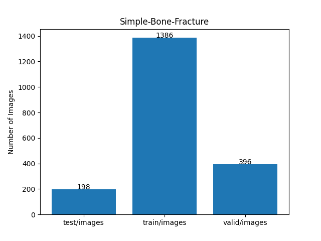 
 
As shown above, the number of images in the training and valid datasets is large enough to use for the
 training set of our segmentation model.
 
<h3>2.2 Derivation of ImageMask Dataset</h3>
The folder structure of <b>Simple Bone Fracture</b> of Original Bone Facture dataset  
</a> is as follows, but it contains no annotation (mask) files.
<pre>
,/Bone Fracture
└─Original
    └─Simple Bone Fracture ( 1,211 files)
         ├─165_Simple Bone Fracture.jpg
...
         └─IMG-20241102-WA0024.jpg

</pre>
<b>Step 1</b> 
We generated a 512x512-pixel cropped gray-scale master images from the JPG files in the <b>Simple Bone Fracture</b> folder.
  
<b>Step 2</b> 
We generated pseudo masks corresponding to the master by applying a segmentation (inference) method of
the pretrained model <a href="https://github.com/sarah-antillia/TensorFlow-FlexUNet-Image-Segmentation-FracAtlas-Fracture">
TensorFlow-FlexUNet-Image-Segmentation-FracAtlas-Fracture</a> to the master.
  
<b>Step 3</b> 
We generated a 512x512-pixel augmented ImageMask dataset from the pseudo masks and the master images
by  applying flipping and rotating augmentation tools to the pairs.
  
<b>Step 4 </b> 
We generated a new pretrained FlexUNet segmentation model by using the augmented ImageMask dataset derived at <b>Step 3</b>.
  
<b>Step 5</b> 
We generated a new pseudo masks to the master images by applying a segmentation method of the new 
pretrained FlexUNet model obtained at <b>Step 4</b>.
  
We iteratively repeated Steps 3 to 5 three times to generate our curated 
<a href="https://drive.google.com/file/d/1nn1wLu2pPTH9N743r9aMCPVlsRyyVkLi/view?usp=sharing">Augmented-Simple-Bone-Fracture-ImageMask-Dataset</a>.
   
<h3>2.3 Train Sample Images and Masks</h3>
<b>Train_sample_images</b> 
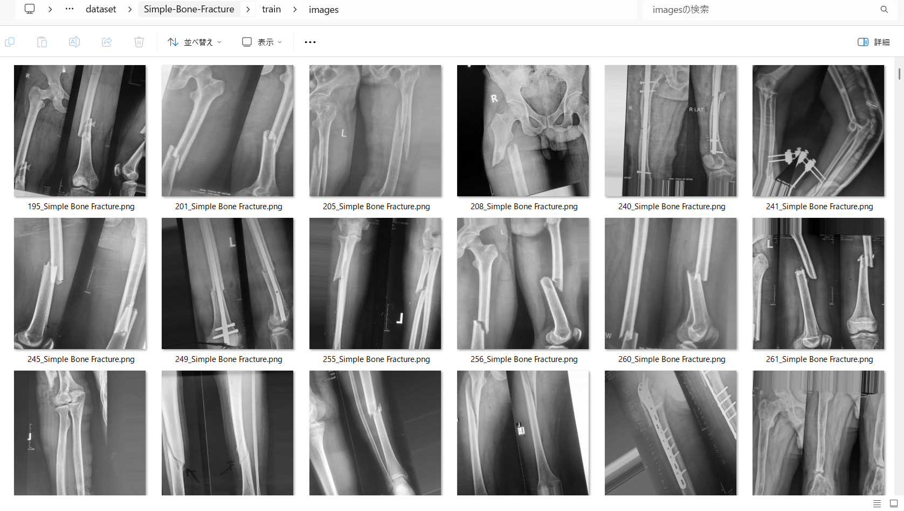
 
<b>Train_sample_masks</b> 
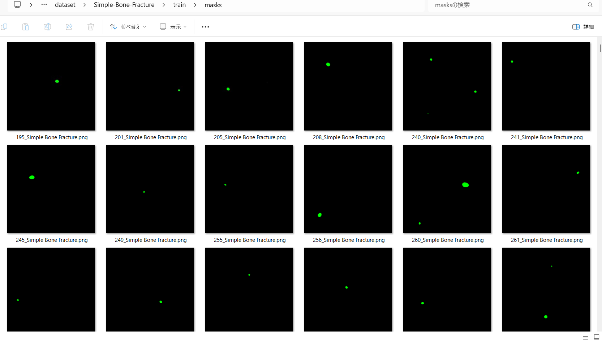
 

<h3>
3 Train TensorFlowFlexUNet Model
</h3>
 We trained the Simple-Bone-Fracture TensorFlowFlexUNet model using the following
<a href="./projects/TensorFlowFlexUNet/Simple-Bone-Fracture/train_eval_infer.config"> <b>train_eval_infer.config</b></a> file.  
Please move to ./projects/TensorFlowFlexUNet/Simple-Bone-Fracture and run the following bat file. 
<pre>
>1.train.bat
</pre>
This runs the following command. 
<pre>
>python ../../../src/TensorFlowFlexUNetTrainer.py ./train_eval_infer.config
</pre>

<b>Model parameters</b> 
Defined a small <b>base_filters=16 </b> and large <b>base_kernels=(11,11)</b> for the first Conv Layer of Encoder Block of 
<a href="./src/TensorFlowFlexUNet.py">TensorFlowFlexUNet.py</a> 
and a large <b>num_layers=8</b> (including a bridge between Encoder and Decoder Blocks).
<pre>
[model]
; You may specify your own UNet class derived from our TensorFlowFlexModel
model         = "TensorFlowFlexUNet"
generator     =  False
image_width    = 512
image_height   = 512
image_channels = 3
num_classes    = 2
base_filters   = 16
base_kernels   = (11,11)
num_layers     = 8
dropout_rate   = 0.03
dilation       = (1,1)
</pre>
<b>Learning rate</b> 
Defined a small learning rate.  
<pre>
[model]
learning_rate  = 0.0001
</pre>
<b>Loss and metrics functions</b> 
Specified "categorical_focal_dice_loss" and <a href="./src/dice_coef_multiclass.py">"dice_coef_hybrid"</a>. 
<pre>
[model]
loss           = "categorical_focal_dice_loss"
metrics        = ["dice_coef_hybrid"]
hybrid_alpha   = 1.6
hybrid_beta    = 0.4
</pre>
<b>Dataset class</b> 
Specifed <a href="./src/ImageCategorizedMaskDataset.py">ImageCategorizedMaskDataset</a> class. 
<pre>
[dataset]
class_name    = "ImageCategorizedMaskDataset"
</pre>
 
<b>Learning rate reducer callback</b> 
Enabled the learning_rate_reducer callback and a small reducer_patience.
<pre> 
[train]
learning_rate_reducer = True
reducer_factor     = 0.5
reducer_patience   = 4
</pre>
<b>Early stopping callback</b> 
Enabled early stopping callback with the patience parameter.
<pre>
[train]
patience      = 10
</pre>

<b>RGB Color map</b> 
Specified RGB color map dict for Simple-Bone-Fracture 2 classes. 
<pre>
[mask]
mask_datatype= "categorized"
mask_file_format = ".png"
; Simple-Bone-Fracture RGB color map dict for 1+1 classes.
;      Background: black, Fracture: green
rgb_map = {(0,0,0):0,(0,255,0):1,}
</pre>

<b>Epoch change inference callback</b> 
Enabled <a href="./src/EpochChangeInferencer.py">epoch_change_infer callback</a></b>. 
<pre>
[train]
epoch_change_infer       = True
epoch_change_infer_dir   =  "./epoch_change_infer"
num_infer_images         = 6
</pre>

By using this callback, on every epoch change, the inference procedure can be called
 for 6 images in the <b>mini_test</b> folder. This will help you confirm how the predicted mask changes 
 at each epoch during your training process.  
  
As shown below, early in the model training, the predicted masks from our FlexUNet segmentation model showed 
discouraging results.
 However, as training progressed through the epochs, the predictions gradually improved. 
   
 
<b>Epoch_change_inference output at starting (epoch 1,2,3)</b> 
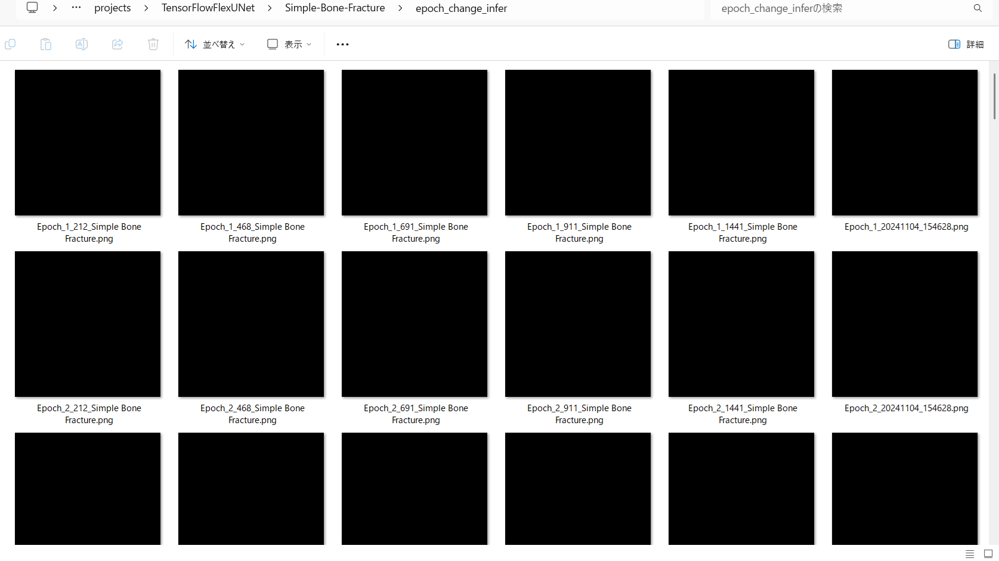 
 
<b>Epoch_change_inference output at middlepoint (epoch 11,12,13)</b> 
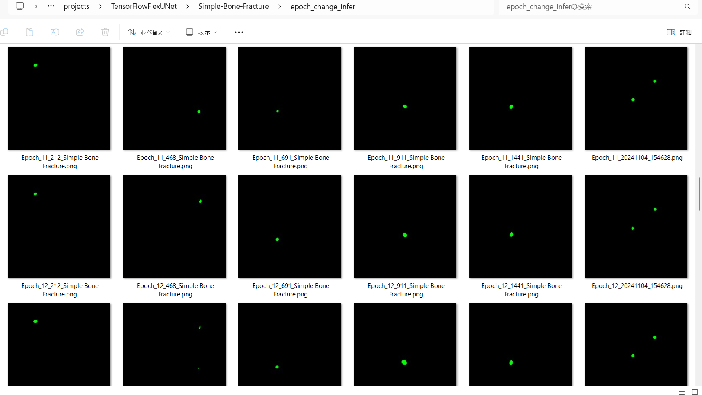 
 
<b>Epoch_change_inference output at ending (epoch 24,25,26)</b> 
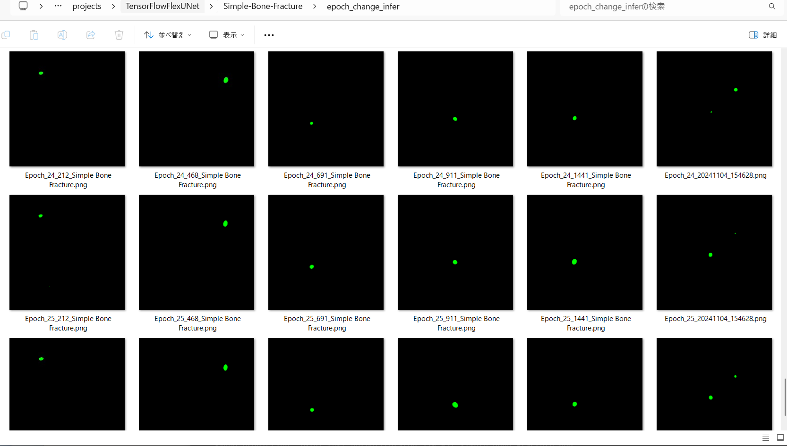 
 
In this experiment, the training process was stopped at epoch 26 by EarlyStoppingCallback. 
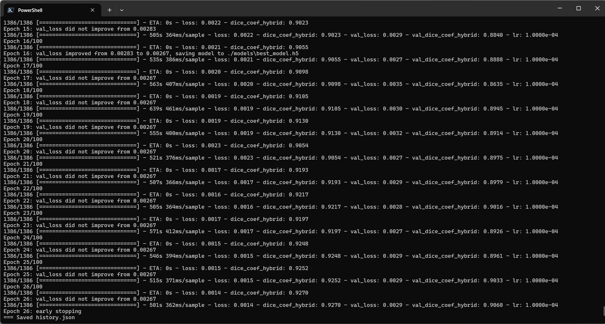 
 
<a href="./projects/TensorFlowFlexUNet/Simple-Bone-Fracture/eval/train_metrics.csv">train_metrics.csv</a> 
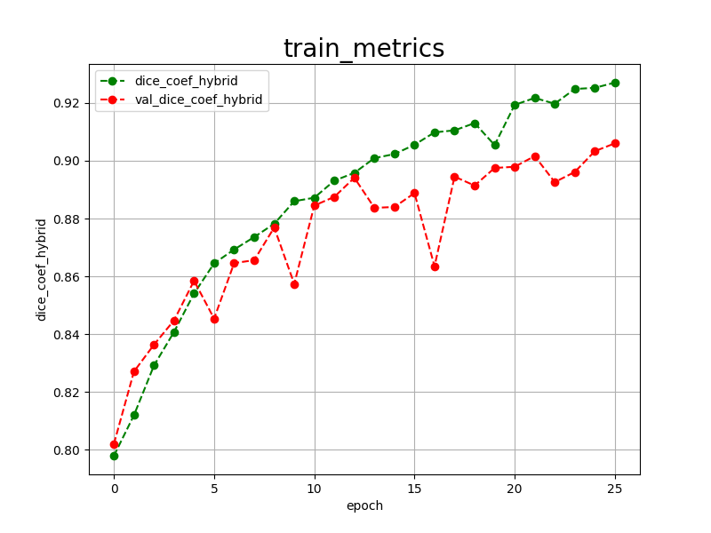 
 
<a href="./projects/TensorFlowFlexUNet/Simple-Bone-Fracture/eval/train_losses.csv">train_losses.csv</a> 
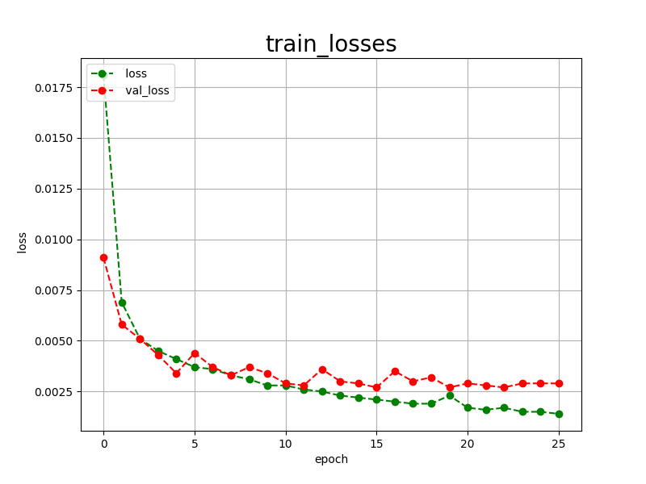 
 
<h3>
4 Evaluation
</h3>
Please move to <b>./projects/TensorFlowFlexUNet/Simple-Bone-Fracture</b> folder, 
and run the following bat file to evaluate the TensorFlowUNet model for Simple-Bone-Fracture. 
<pre>
./2.evaluate.bat
</pre>
This runs the following command.
<pre>
python ../../../src/TensorFlowFlexUNetEvaluator.py ./train_eval_infer.config
</pre>

Evaluation console output: 
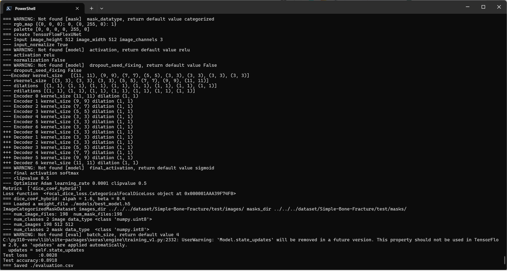
  Image-Segmentation-Simple-Bone-Fracture

<a href="./projects/TensorFlowFlexUNet/Simple-Bone-Fracture/evaluation.csv">evaluation.csv</a> 
The loss (categorical_focal_dice_loss) on this Simple-Bone-Fracture/test was low, but dice_coef_hybrid was not high, as shown below.
 
<pre>
categorical_focal_dice_loss,0.0028
dice_coef_hybrid,0.8918
</pre>
 

<h3>
5 Inference
</h3>
Please move to <b>./projects/TensorFlowFlexUNet/Simple-Bone-Fracture</b> folder
and run the following bat file to infer segmentation regions for images using the trained TensorFlowUNet model for Simple-Bone-Fracture. 
<pre>
./3.infer.bat
</pre>
This runs the following command.
<pre>
python ../../../src/TensorFlowFlexUNetInferencer.py ./train_eval_infer.config
</pre>

<b>mini_test_images</b> 
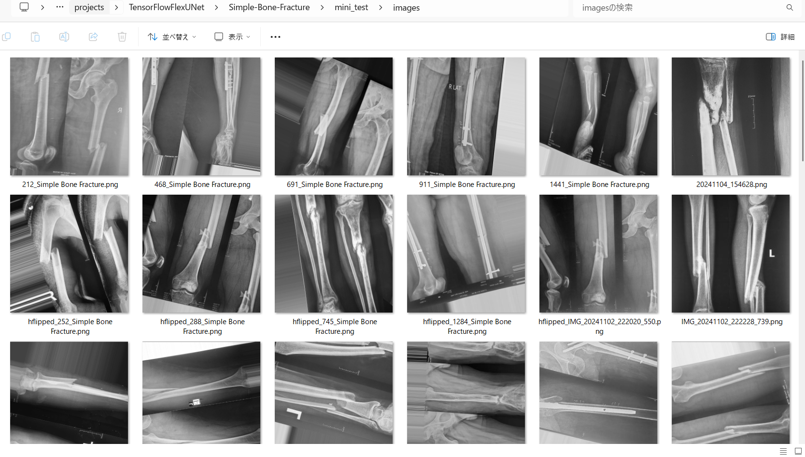 
<b>mini_test_mask(ground_truth)</b> 
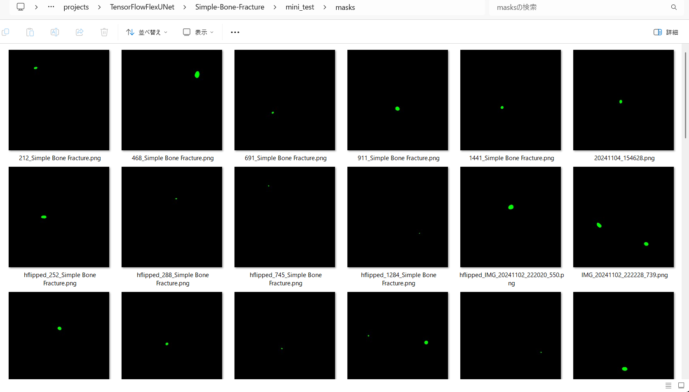 

<b>Inferred test masks</b> 
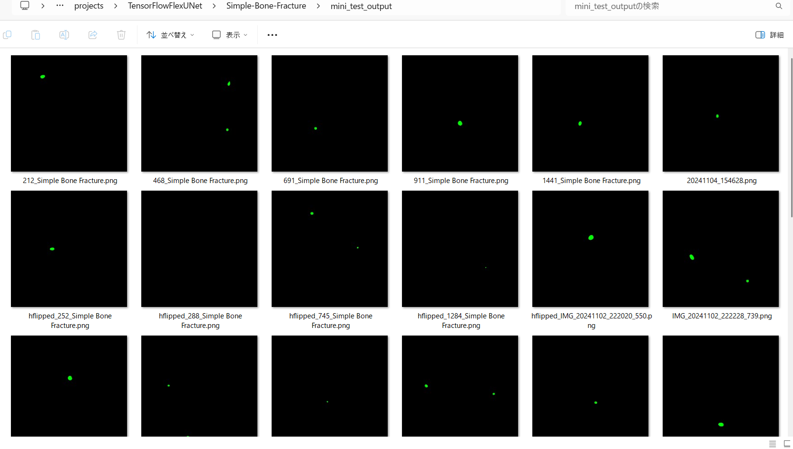 
 

<b>Enlarged images and masks for Simple-Bone-Fracture Images of 512x512 pixels</b> 
As shown below, the inferred masks look similar to the ground truth masks. 
 
<table>
<tr>
<th width="320" height="auto">Image</th>
<th width="320" height="auto">Mask (ground_truth)</th>
<th width="320" height="auto">Inferred-mask</th>
</tr>
<tr>
<td></td>
<td></td>
<td></td>
</tr>
<tr>
<td></td>
<td></td>
<td></td>
</tr>
<tr>
<td>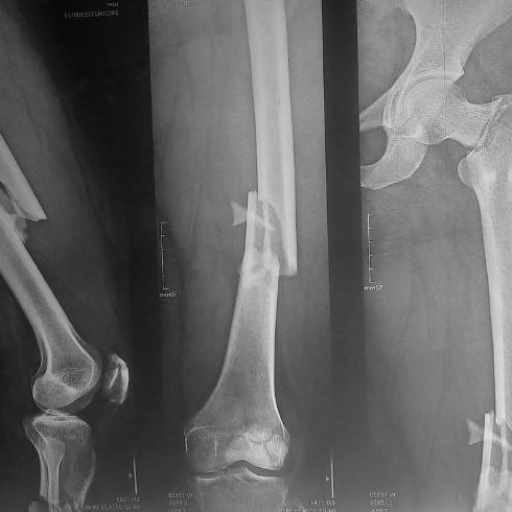</td>
<td></td>
<td></td>
</tr>
<tr>
<td></td>
<td></td>
<td></td>
</tr>
<tr>
<td></td>
<td></td>
<td></td>
</tr>
<tr>
<td></td>
<td></td>
<td></td>
</tr>
</table>

 
<h3>
References
</h3>
<b>1. FracAtlas: A Dataset for Fracture Classification, Localization and Segmentation of Musculoskeletal 
Radiographs</b> 
Iftekharul Abedeen, Md. Ashiqur Rahman, Fatema Zohra Prottyasha, Tasnim Ahmed,  
 Tareque Mohmud Chowdhury & Swakkhar Shatabda  
<a href="https://www.nature.com/articles/s41597-023-02432-4">https://www.nature.com/articles/s41597-023-02432-4</a>
  
<b>2. The impact of implementing backbone architectures on fracture segmentation in X-ray images</b> 
Salih Turk, Ozkan Bingol, Ahmet Coskuncay, Tolga Aydin 
<a href="https://www.sciencedirect.com/science/article/pii/S2215098624002696">
https://www.sciencedirect.com/science/article/pii/S2215098624002696</a>
  
<b>3. WCAY object detection of fractures for X-ray images of multiple sites</b> 
Peng Chen, Songyan Liu, Wenbin Lu, Fangpeng Lu, Boyang Ding 
<a href="https://pmc.ncbi.nlm.nih.gov/articles/PMC11535499/">https://pmc.ncbi.nlm.nih.gov/articles/PMC11535499/</a>
  
<b>4. TensorFlow-FlexUNet-Image-Segmentation-FracAtlas-Fracture</b> 
Toshiyuki Arai 
<a href="https://github.com/sarah-antillia/TensorFlow-FlexUNet-Image-Segmentation-FracAtlas-Fracture">
https://github.com/sarah-antillia/TensorFlow-FlexUNet-Image-Segmentation-FracAtlas-Fracture
</a>
  
<b>5. TensorFlow-FlexUNet-Image-Segmentation-Model</b> 
Toshiyuki Arai 
<a href="https://github.com/sarah-antillia/TensorFlow-FlexUNet-Image-Segmentation-Model">
https://github.com/sarah-antillia/TensorFlow-FlexUNet-Image-Segmentation-Model
</a>
  

